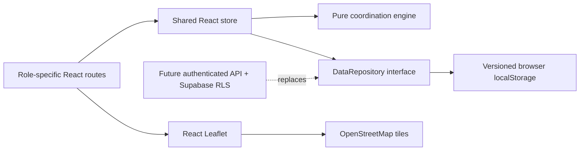

# CivicSync architecture

## System boundaries

The deployed app is a static SPA. No backend or server authorization exists in this demo. Network access is only necessary for initial hosting, map tiles, and optional fonts. Computation and sample records remain client-side.

## Data model

- Project: unique ID, descriptive/accountability fields, department, type, status, dates, progress, excavation flag, road segment, point coordinates, delay reason, embedded project updates.
- RoadSegment: stable ID, name, verification flag within the fictional dataset, approximate line geometry. Project point coordinates are separately stored and shown as markers.
- ProjectUpdate: unique ID, UTC timestamp, responsible department, human-readable event. Schedule edits capture old and new dates; status/progress/delay changes append an event.
- Complaint: generated reference, category, road/location, optional project link, photograph data URL, status, creation timestamp, ordered status events. A deleted linked project leaves a traceable reference rather than deleting the report.
- Conflict: deterministic pair ID, involved project IDs, primary type, severity, evidence, optional distance, explanation, recommendation. Derived from projects rather than stored as authoritative alerts.
- Coordination: last conflict snapshot, review/acknowledgment status, timestamped notes attributed to the selected demo role. Save operations snapshot old and new detected pairs so cleared alerts remain inspectable.
- Database: schema version, projects, complaints, coordination records and configurable window. Departments are a typed catalog. Demo roles are ephemeral UI state; there are no invented user accounts.

## Coordination rules

Dates are strict YYYY-MM-DD, parsed at UTC midnight to avoid DST issues. Reversed or invalid ranges are skipped. Completed projects are excluded. Sort unique pair traversal by ID; skip pairs with identical IDs.

For each pair:

1. Shared verified segment ID → authoritative match within the demo dataset.
2. Distinct nonempty segment IDs → no match.
3. Otherwise, normalized equal road names AND Haversine distance ≤150 m → uncertain location candidate only.
4. Compute gap = max(startA,startB) − min(endA,endB), in days. Gap ≤0 is inclusive overlap.
5. Detect overlap, or (0 < gap ≤ window AND both excavate AND different departments), or (gap ≤ window AND matching types).
6. Emit one stable pair alert with priority: unverified location review, overlap, repeated excavation, duplicate work. Duplicate evidence is additionally explained even when overlap is the primary type.

Severity:

| Evidence / condition                                     | Severity |
| -------------------------------------------------------- | -------- |
| Unverified name + distance candidate                     | Low      |
| Verified overlap, both excavating, different departments | Critical |
| Verified repeated excavation or matching work types      | High     |
| Other verified overlapping work                          | Medium   |

Recommendations propose coordinated sequencing or moving work outside the window. They do not promise capacity, engineering safety, permit approval, or elimination of all traffic disruption. Two same-department excavations of different types with overlapping schedules are Medium; duplication can elevate them to High.

## Mutation flow

The editor validates first, then constructs the next immutable state and appends a public event. `commit` detects conflicts on the previous and proposed states, stores conflict snapshots, then writes the entire next database before changing UI state. Storage errors leave the previous state in place and display an alert. Current conflict views always derive fresh results, so acknowledgments cannot hide ongoing clashes. Seed records are returned when the key is absent; the first successful mutation persists them.

Deleting a project requires an administrator role and confirmation. Complaints follow sequential transitions in the UI. Neither control is a security boundary in demo mode. Data loss/corruption does not trigger silent reset; incompatible data fails into an error boundary.

## Production extension

The synchronous repository is a clear replacement boundary, not an implemented Supabase connector. Convert it to async query/mutation operations, introduce loading/retry states, server schema validation, authenticated user/department claims, row-level authorization, database transactions, immutable audit events, and private image storage. Re-run the engine server-side on authoritative records. Cross-device complaint tracking needs an authenticated or narrowly scoped reference lookup endpoint; random references alone are insufficient authorization. Use geospatial indexes and canonical GIS road segments for scale.

## UI structure

- App: error boundary, role switcher, navigation, router, responsive shell.
- Dashboard: lazy-loaded analytics; all metrics derive from stored data.
- Projects: searchable list/map, validated editor, detail timeline.
- Coordination: active/cleared views, methodology, notes, window settings.
- Citizen: public browsing, reports, optional geolocation, tracking and admin lifecycle.
- CityMap/UI: reusable map, badges, progress, filters, tables, export.

Custom CSS uses navy, blue, teal, compact typography, responsive grids, explicit focus rings and reduced-motion rules. Maps use OSM attribution. The project list is a usable alternative when tile networking fails.
