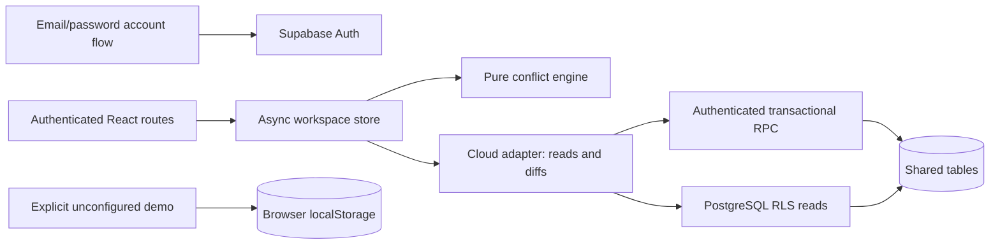

# CivicSync architecture

## Trust boundaries

The static SPA uses a public publishable key. Supabase Auth validates passwords and manages sessions. The database is the authorization boundary; frontend role checks only improve the interface. Configured builds never expose the local demo role switcher. Missing configuration opens a setup-aware login screen with disabled account actions.

## Identity

An `auth.users` trigger creates `profiles(id, display_name, role, department)`. It always sets Citizen through the table default and ignores role/department claims in user metadata. Authenticated users can select their own profile; administrators can select profiles. No browser role can directly update profiles. The guarded `assign_civic_role` function authorizes the caller from the database, requires an existing account, validates assignments, and disallows changing one's own role. The first administrator is bootstrapped by the project owner in the SQL Editor after email confirmation.

The client verifies a restored session via `getUser`, loads the profile and responds to sign-out and recovery events. Profile verification also runs when the window regains focus. The provider remounts when user/role/department changes to clear the previous permission scope. Server permissions use current database values, not stale role claims in a token.

## Data

- `departments` and `road_segments`: shared catalogs; road coordinate arrays, verification and illustrative flags. Administrators add records through a guarded RPC.
- `project_updates`: append-only server-generated timeline rows linked to projects/departments, maintained transactionally.
- `coordination_projects`: relational links between persisted conflict snapshots and surviving projects.
- `projects`: ID, department and optional road foreign keys, illustrative flag, typed project JSON payload, server modification timestamp. Authenticated accounts can browse all projects.
- `complaints`: reference, server-assigned owner ID, nullable project foreign key, payload and modification timestamp. Citizens see only their own; officers see own reports and those linked to their department's projects; administrators see all.
- `coordination`: pair ID and review/note/snapshot payload. Readable by staff, writable only by administrators or an involved department officer.
- `settings`: the single city coordination window; readable by authenticated users, writable only by administrators.
- `profiles`: trusted role and department assignment.

Payload models remain in `src/model.ts`. The SQL function validates essential fields rather than trusting TypeScript. Images are bounded data URLs stored with their protected report record. No public storage bucket exposes complaint photographs. Connected mode never uses the built-in sample catalog. `civic_snapshot` is a stable SECURITY INVOKER read that aggregates every authorized table under its RLS policies in one transaction. It assembles project timelines from relational rows and avoids REST per-table row limits. JSONB preserves the existing domain model; triggers synchronize relational keys/history in the same write transaction. Deleting a project removes its timeline and live coordination junctions, while report references and coordination snapshots survive.

## Writes and concurrency

`changesBetween` sends only changed visible records with `before` and `after` payloads. It never submits a global replacement database. `civic_commit` obtains a transaction advisory lock, checks the caller's actual role/department, checks the prior JSONB value, validates the new payload and applies the batch atomically. Stale writes fail rather than overwrite. An error in any operation rolls back the batch.

Direct table INSERT/UPDATE/DELETE privileges are revoked from browser roles. RPC execution is revoked from anonymous users and PUBLIC. SECURITY DEFINER helpers use an empty search path and explicitly qualified table/function names.

Project creation/editing is staff-only and department-scoped; deletion is administrator-only. Project history is preserved and new events are server-stamped. Report ownership comes from `auth.uid()`, never submitted owner fields. Existing report content is immutable; status may advance exactly one step. Report events and coordination note authors/times are generated server-side.

After a successful mutation, the store reloads authorized data. If the write succeeds but refresh fails, the UI says so rather than claiming the write failed. Users can explicitly refresh. No realtime subscription is enabled yet.

## Conflict engine

For every unique project pair: reject invalid/reversed UTC date ranges, completed projects and self-comparisons. Prefer equal verified stored segment IDs. Different nonempty IDs never match through proximity. Otherwise, matching normalized names plus Haversine distance ≤150 m produce only uncertain location-review candidates.

Gap = later start − earlier finish in UTC days; gap ≤0 means inclusive overlap. Match overlap, cross-department repeated excavation within the configured window, or matching work types within the window. Emit one stable pair alert with explanations of additional duplicate evidence.

Severity: Critical for verified overlapping cross-department excavation; High for repeated excavation or potential duplicate work; Medium for other verified overlaps; Low for uncertain locations. Recommendations support planning, not engineering approval.

Conflicts are recomputed from projects in the client. Staff changes snapshot relevant old/new alerts. Acknowledgment does not suppress a currently detected conflict. Cleared means a captured pair no longer meets the current rules, which can reflect schedule, completion, deletion or rule changes. Server authorization never depends on a client conflict score.

## Local demo

Without backend configuration, the user may explicitly enter a local demo. It stores versioned data under `civicsync-demo-v1`, uses fictional records and simulated roles, and never writes to Supabase. This path retains the hackathon walkthrough. The backend starts empty and only an administrator's atomic explicit import adds sample projects and roads; demo complaints are not uploaded.

## Verification and remaining infrastructure

Vitest covers application logic and provider-request handling. PGlite runs the actual SQL migrations and tests RLS, escalation denial, report privacy, department scope, status transitions, server history, concurrency and rollback. Playwright tests the unconfigured login entry and explicit demo workflows.

Real hosted email confirmation, reset delivery and multi-browser access must be checked after the owner provisions Supabase, applies both migrations and configures SMTP/redirect URLs. See AUTH_SETUP.md. Future scaling work includes pagination, spatial indexes, private object storage, realtime refresh, canonical road data and server-side conflict materialization.
