<div align="center">

# CivicSync

### One City. One Map. Smarter Public Works.

A shared public works platform that makes infrastructure schedules visible—and coordination conflicts explainable.

**BITS AND BYTES 2026 · IIITDM Kancheepuram · CivicTech**


**[Live Demo](https://civicsync-smart-city.vercel.app/) · [Video Walkthrough](demo/CivicSync_Hackathon_Demo.mp4) · [Features](#features) · [Architecture](#architecture) · [Getting Started](#getting-started)**

</div>

[](https://civicsync-smart-city.vercel.app/)

> **Real accounts. Shared records. Illustrative city data.** The deployed app uses Supabase authentication and persistence. Showcase projects and geometry are labeled samples, not official municipal records. The live application requires sign-in; the video is available without an account.

| See the city                                 | Coordinate the work                                    | Follow the outcome                                        |
| -------------------------------------------- | ------------------------------------------------------ | --------------------------------------------------------- |
| Projects, timelines and map-based visibility | Explainable schedule conflicts and departmental review | Citizen reports with a saved reference and status history |

## Watch CivicSync in Action

**Three minutes through the deployed application:** administrator dashboard → overlapping excavation → officer progress and coordination → citizen reporting and tracking.

[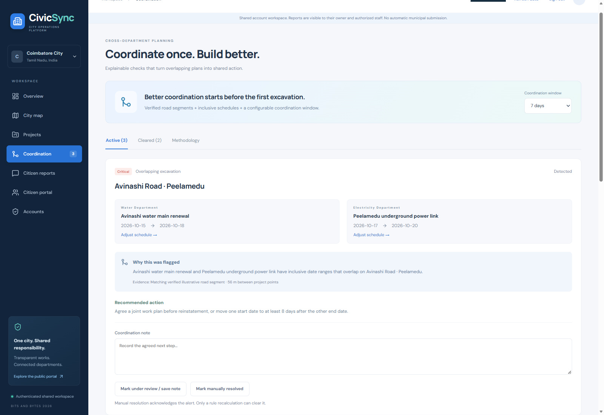](demo/CivicSync_Hackathon_Demo.mp4)

**[Watch / open the MP4](demo/CivicSync_Hackathon_Demo.mp4)** · **[Download the video](https://github.com/poojaaxx/civicsync-smart-city/raw/refs/heads/main/demo/CivicSync_Hackathon_Demo.mp4)**

179.98 seconds · 1920 × 1080 · 2.92 MiB · English explanatory captions, no audio narration. GitHub may offer a download instead of an inline player. The original MP4 is preserved. [Recording details](demo/README.md).

## Why CivicSync

### The problem

Infrastructure information is fragmented across departments. A newly repaired road can be excavated again for another utility; overlapping schedules can contribute to disruption and delays. Residents have limited visibility into responsibility, progress and follow-up.

### Our solution

CivicSync connects **citizens, department officers and city administrators** around the same project register. Departments see explainable scheduling alerts, officers document progress and coordination, and citizens follow works and their own complaints.

This is a proposed civic technology solution with a functioning shared backend. It is **not connected to a government works system**, and reports are not automatically sent to a municipality. Reduced disruption is the intended impact, not a measured outcome claimed by this project.

## Features

| Capability                | What is implemented                                                                                                                                                |
| ------------------------- | ------------------------------------------------------------------------------------------------------------------------------------------------------------------ |
| **Operations dashboard**  | Project, status, conflict and report counts; department/status charts; monthly activity; upcoming work; recent updates; JSON export                                |
| **Infrastructure map**    | OpenStreetMap tiles, stored road geometry, project markers, status colors, conflict indicators, popups and detail links; project lists remain usable if tiles fail |
| **Project management**    | Validated creation/editing, administrator deletion, schedules, coordinates, department, contractor, responsible authority, progress and delay reasons              |
| **Public timelines**      | Append-only shared project updates with server-generated history                                                                                                   |
| **Conflict coordination** | Live unsaved schedule preview, computed severity, evidence, recommendations, notes, acknowledgments and cleared alert history                                      |
| **Citizen reporting**     | Search and optional nearby search, categories, optional photograph, reference lookup and sequential status history                                                 |
| **Account access**        | Email/password signup, confirmation, sign-in, sign-out and password recovery; trusted role assignment                                                              |
| **Usability**             | Responsive layouts, keyboard focus, skip navigation, reduced-motion support and loading/error/empty states                                                         |

## The Conflict Detection Engine

**The innovation is an explainable coordination check against stored infrastructure schedules.** It is deterministic TypeScript logic—not a machine-learning model, an engineering approval system or a claim of proven cost savings.

**Example:** Water Department schedules pipeline excavation on a stored road segment for **15–18 October**. Electricity Department schedules cable excavation on the same verified segment for **17–20 October**. CivicSync identifies inclusive overlap, emits a **Critical** alert, explains the evidence and recommends a joint work plan or schedule separation.

<details>
<summary><strong>▶ See the genuine schedule-check interaction · 8-second excerpt</strong></summary>

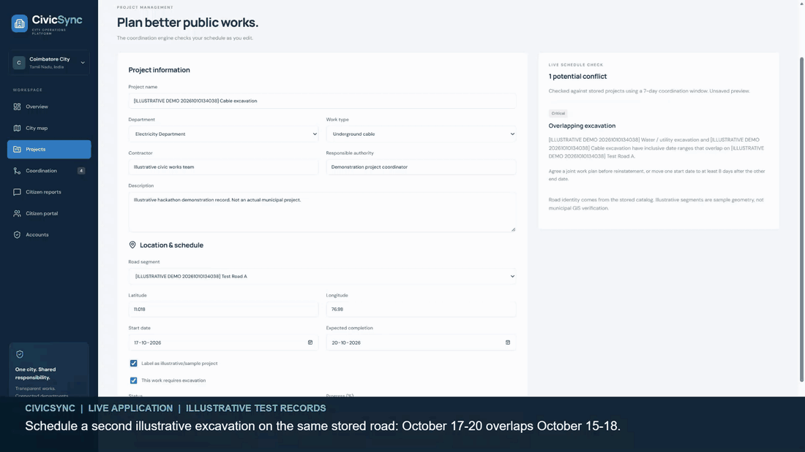

Excerpt from the existing walkthrough. Captions identify the illustrative records; no outcomes were simulated for the animation.

</details>

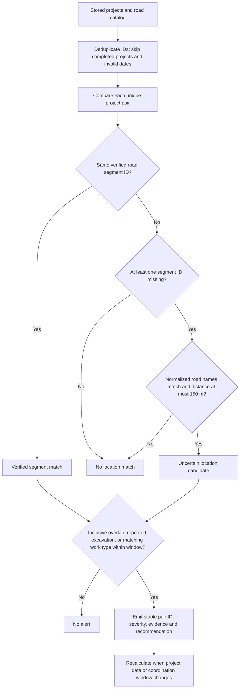

| Severity     | Actual rule, in precedence order                                                                          |
| ------------ | --------------------------------------------------------------------------------------------------------- |
| **Low**      | An uncertain location candidate meeting a schedule/work rule; proximity is not proof of a shared road     |
| **Critical** | Verified segment, overlapping excavation, different departments                                           |
| **High**     | Verified repeated cross-department excavation within the window, or matching work types within the window |
| **Medium**   | Other verified overlaps not classified above                                                              |

Matching **verified stored segment IDs** take priority. Distinct nonempty IDs cannot match through proximity. When an ID is missing, normalized road names and Haversine distance ≤150 m can identify only a review candidate. Coordinates are validated; a segment's verification flag reflects catalog administration, not independent GIS certification.

The configurable window is **0 / 3 / 7 / 14 / 30 days**. A shared date endpoint counts as overlap. Repeated excavation requires both projects to excavate, different departments and a positive gap within the window. Matching work types suggest potential duplication, not proven waste. The pairwise engine is **O(n²)** and emits stable IDs with explanations.

**Acknowledging an alert does not suppress detection.** Captured alerts move to cleared history when current rules no longer match—for example after rescheduling, completion, deletion or a window change. [Engine source](src/engine.ts) · [Architecture details](ARCHITECTURE.md).

## Three Roles, One Shared Workspace

| Capability                                 | Citizen                           | Department Officer                                                | City Administrator |
| ------------------------------------------ | --------------------------------- | ----------------------------------------------------------------- | ------------------ |
| Browse projects, maps and public timelines | Yes                               | Yes                                                               | Yes                |
| Submit and track own reports               | Yes                               | Yes                                                               | Yes                |
| Create/edit projects                       | —                                 | Assigned department                                               | All departments    |
| Delete projects                            | —                                 | —                                                                 | Yes                |
| Review coordination and save notes         | —                                 | Involved department                                               | All departments    |
| View/update staff-managed complaints       | Own reports only; no status edits | Own reports visible; staff updates for linked department projects | All reports        |
| Change city coordination window            | —                                 | —                                                                 | Yes                |
| Add catalog entries and assign access      | —                                 | —                                                                 | Yes                |

**Every public registration starts as Citizen.** Privileged roles require trusted assignment, and an officer must belong to a valid department. Signup metadata cannot promote an account. The first administrator is bootstrapped through the owner's Supabase SQL Editor; subsequent assignments use the guarded Accounts operation. Users cannot change their own role through that operation.

The authorization boundary is the database: **Supabase RLS protects reads**, and authenticated transactional functions validate mutations. Direct browser table writes are denied. Frontend visibility checks are not the security boundary. Citizen report ownership comes from `auth.uid()`; knowing another citizen's reference does not grant access. [Secure account and role setup](AUTH_SETUP.md#three-account-role-setup-and-verification).

## Product Gallery

Fresh captures of the deployed application using authorized accounts and illustrative records. Account identities are masked; the complaint shown is explicitly nonpersonal test content. Click an image for the full resolution.

| Administrator overview                                                                                                                                               | Interactive infrastructure map                                                                                                                                |
| -------------------------------------------------------------------------------------------------------------------------------------------------------------------- | ------------------------------------------------------------------------------------------------------------------------------------------------------------- |
| [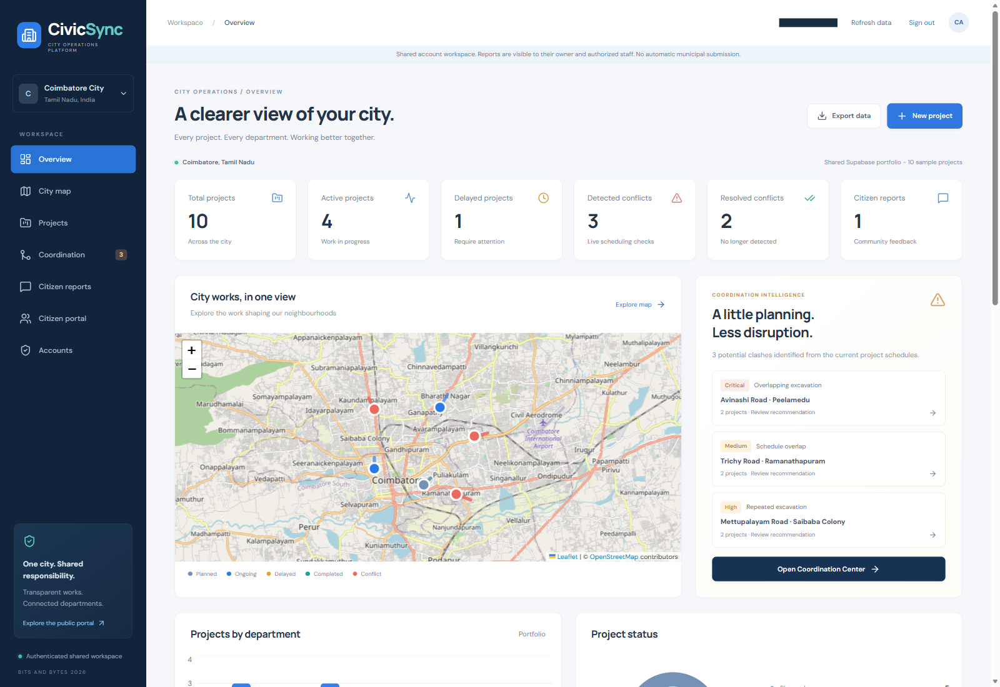](docs/assets/screenshots/administrator-dashboard.png) | [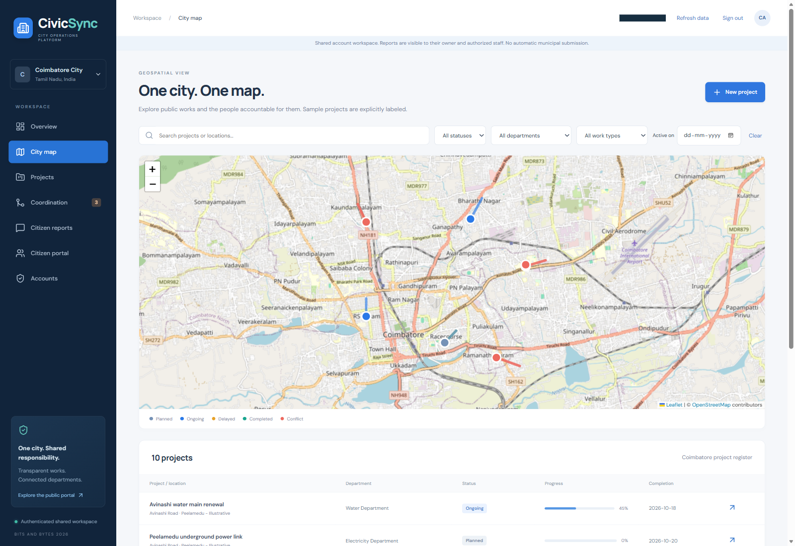](docs/assets/screenshots/infrastructure-map.png) |
| Portfolio statistics and attention areas                                                                                                                             | Explore project locations and infrastructure schedules                                                                                                        |

<details>
<summary><strong>View six more application screens</strong></summary>

| Conflict Detection Center                                                                                                                                              | Department Officer dashboard                                                                                                                                                             |
| ---------------------------------------------------------------------------------------------------------------------------------------------------------------------- | ---------------------------------------------------------------------------------------------------------------------------------------------------------------------------------------- |
| [](docs/assets/screenshots/conflict-detection.png) | [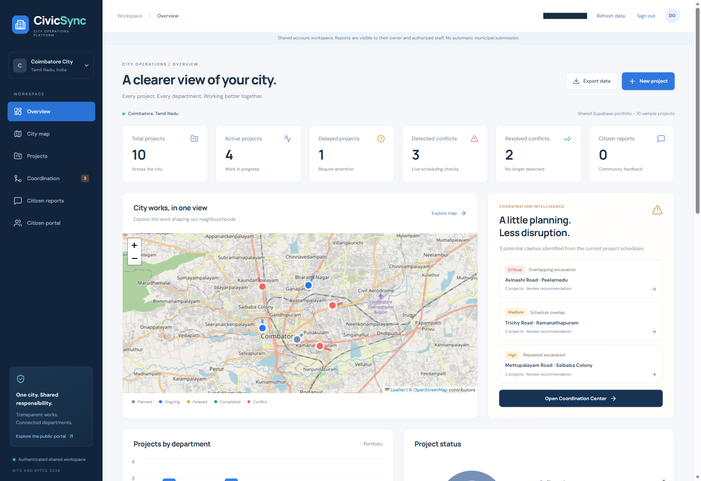](docs/assets/screenshots/department-officer-dashboard.png) |
| Severity, evidence and a coordination recommendation                                                                                                                   | Shared city visibility; editing permissions remain department-scoped                                                                                                                     |

| Citizen portal                                                                                                                               | Complaint tracking                                                                                                                                                       |
| -------------------------------------------------------------------------------------------------------------------------------------------- | ------------------------------------------------------------------------------------------------------------------------------------------------------------------------ |
| [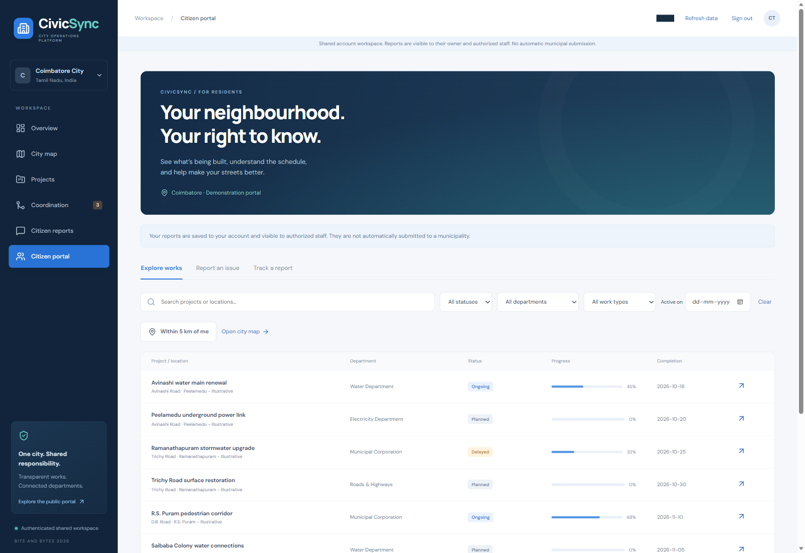](docs/assets/screenshots/citizen-portal.png) | [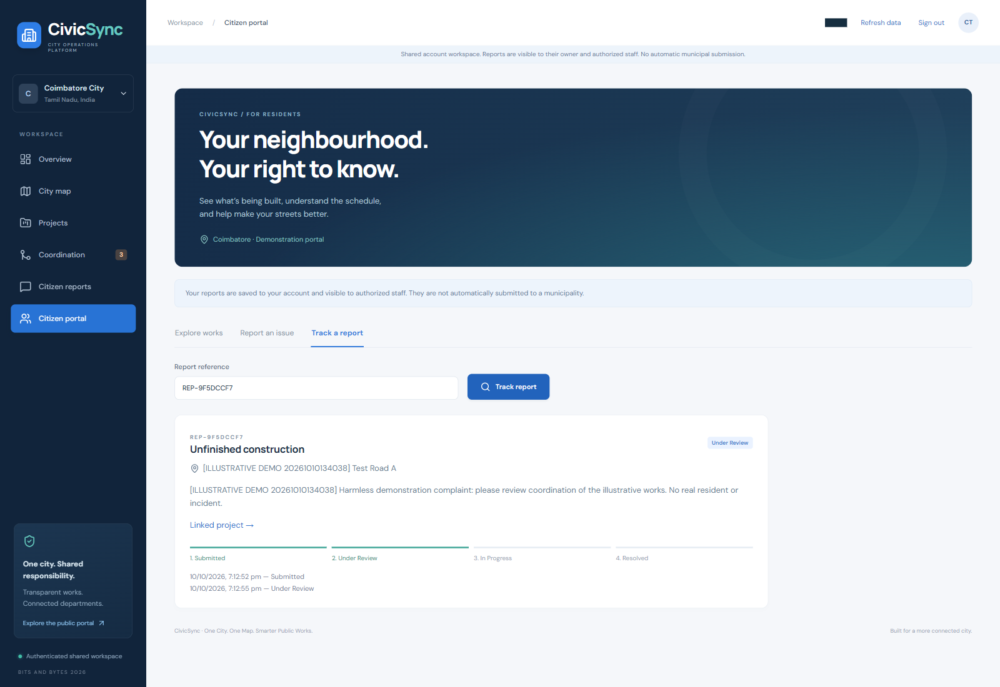](docs/assets/screenshots/complaint-tracking.png) |
| Browse works and report an issue                                                                                                             | Follow a saved reference and status history                                                                                                                              |

| Project management                                                                                                                                                  | Project timeline                                                                                                                                                           |
| ------------------------------------------------------------------------------------------------------------------------------------------------------------------- | -------------------------------------------------------------------------------------------------------------------------------------------------------------------------- |
| [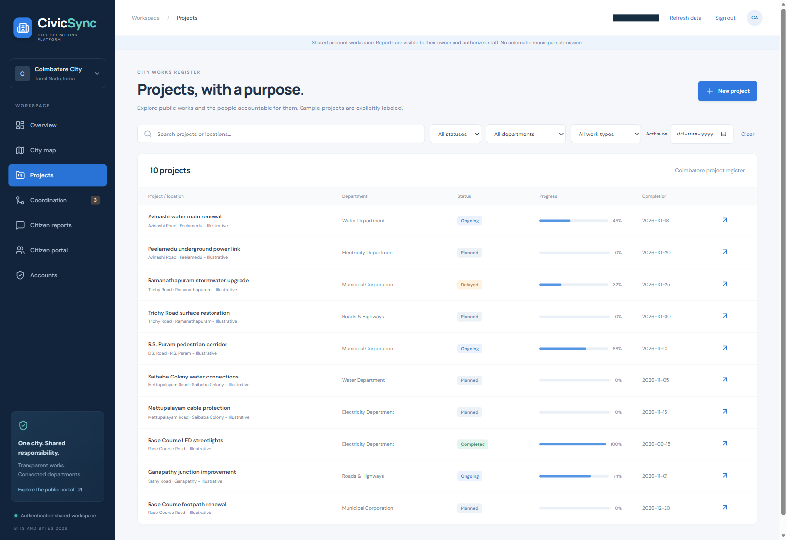](docs/assets/screenshots/project-management.png) | [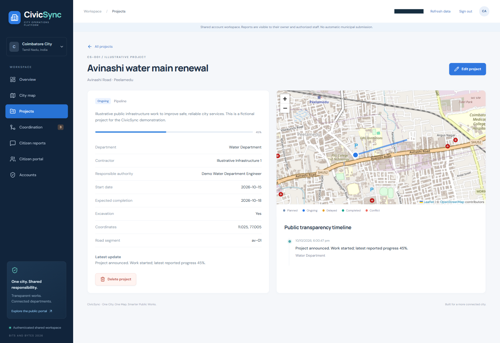](docs/assets/screenshots/project-timeline.png) |
| Search, filter and open project records                                                                                                                             | Responsibility, dates, progress and recorded updates                                                                                                                       |

</details>

<details>
<summary><strong>▶ Citizen reporting in motion · 8-second excerpt</strong></summary>

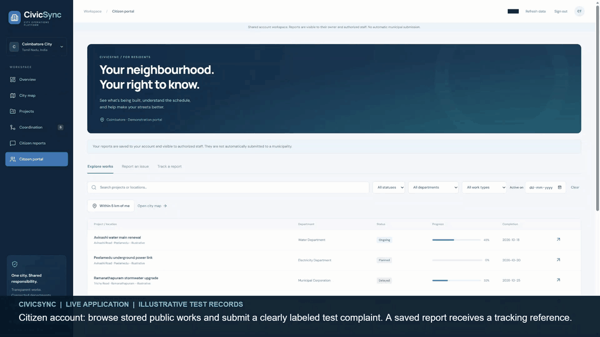

The full walkthrough shows the officer's saved status change reflected in the citizen's view after refresh. Reports are shared within CivicSync, not automatically submitted to a municipality.

</details>

## Architecture

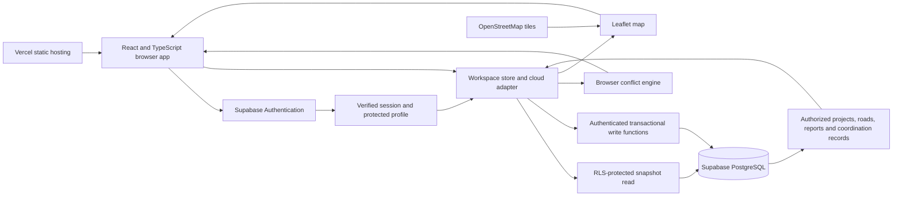

Supabase persists profiles, departments, road segments, projects, project updates, complaints, coordination records/relationships and settings. The dashboard, map, filters, export and conflict checks derive from the authorized snapshot. Map tiles come from OpenStreetMap.

- **Atomic reads and writes:** `civic_snapshot` loads the authorized portfolio under RLS without per-table REST row truncation. `civic_commit` validates changed records, role/department scope and previous values; stale edits fail and invalid batches roll back.
- **Explicit refresh:** successful writes reload data. Use **Refresh data** or reload for other users' latest changes. There are no realtime subscriptions.
- **Protected history:** project timelines and report-status events are generated server-side. Report content is immutable after submission; statuses advance **Submitted → Under Review → In Progress → Resolved** one step at a time.
- **Separate demonstration mode:** without Supabase configuration, an explicit browser-local demo is available and account actions are disabled. Configured builds remove the demo role switcher. Local demo records never upload automatically.

A new database starts empty with starter departments. An administrator may explicitly import ten fictional Coimbatore projects and illustrative roads. The local sample portfolio includes three deliberate conflicts and one demo report; the shared import does not upload demo complaints.

<details>
<summary><strong>Code map and implementation decisions</strong></summary>

| Location                                                | Responsibility                                                         |
| ------------------------------------------------------- | ---------------------------------------------------------------------- |
| `src/auth.tsx`, `src/supabase.ts`, `src/auth-config.ts` | Session lifecycle, profile verification and public configuration guard |
| `src/cloud.ts`                                          | Authorized reads and record-level mutation diffs                       |
| `src/store.tsx`                                         | Async saves, conflict snapshots, refresh and error handling            |
| `src/engine.ts`                                         | Pure conflict detection and project validation                         |
| `src/repository.ts`                                     | Isolated local demo persistence                                        |
| `supabase/migrations/`                                  | Relationships, RLS, validation and transactional authorization         |

JSONB payloads preserve the UI domain model while foreign keys and server-maintained history enforce relationships. Complaint photographs are bounded data URLs inside protected rows, not public storage objects. Database permissions do not depend on client-generated conflict scores.

</details>

[Read the full architecture and trust boundaries →](ARCHITECTURE.md)

## Tech Stack

| Layer              | Technologies used                                               |
| ------------------ | --------------------------------------------------------------- |
| Frontend           | React 19, TypeScript, Vite, React Router, custom responsive CSS |
| Visualization      | Recharts, Lucide icons                                          |
| Backend & database | Supabase JS, PostgreSQL, RLS, transactional SQL functions       |
| Authentication     | Supabase email/password authentication and protected profiles   |
| Mapping            | Leaflet, React Leaflet, OpenStreetMap                           |
| Testing & quality  | Vitest, Testing Library, PGlite, Playwright, ESLint, Prettier   |
| Deployment         | Vercel; SPA route rewrites in `vercel.json`                     |

See [package.json](package.json) and [package-lock.json](package-lock.json) for exact versions. Badges identify technology; they are not live build-status claims. No license badge is shown because this repository has no LICENSE file.

## Getting Started

**Prerequisites:** Node.js **22.12+** (verified with Node 24), npm, and a Supabase project for real accounts.

```sh
git clone https://github.com/poojaaxx/civicsync-smart-city.git
cd civicsync-smart-city
npm ci
```

Create an ignored `.env.local` with your own public client configuration:

```dotenv
VITE_SUPABASE_URL=https://YOUR-PROJECT.supabase.co
VITE_SUPABASE_ANON_KEY=YOUR-PUBLIC-PUBLISHABLE-OR-ANON-KEY
```

`VITE_SUPABASE_PUBLISHABLE_KEY` is the preferred alternative to `VITE_SUPABASE_ANON_KEY`; the existing alias is supported. Set one public key variable. Never place service-role keys, secret keys or database passwords in frontend variables. The build-time configuration guard rejects privileged keys; Supabase handles passwords.

In your trusted Supabase **SQL Editor**, apply these complete migrations **in order, once**:

1. [001 — Authenticated workspace](supabase/migrations/202610100001_authenticated_workspace.sql)
2. [002 — Relational catalog](supabase/migrations/202610100002_relational_catalog.sql)
3. [003 — Coordination authorization](supabase/migrations/202610100003_coordination_authorization.sql)

**Migration 003 is required.** It validates both existing and replacement coordination records to prevent unauthorized officer changes. If 001 and 002 are already applied, apply only 003; do not drop tables or blindly rerun initial migrations.

Follow [AUTH_SETUP.md](AUTH_SETUP.md) to enable email confirmation, configure local/deployed redirect URLs and SMTP, bootstrap your first administrator, and assign officers to valid departments. New public accounts remain Citizens. Hosted email delivery depends on your Supabase configuration.

```sh
npm run dev
```

Open **http://127.0.0.1:5173**. Restart Vite after changing environment variables. Without Supabase configuration, choose **Explore local demo** explicitly; this creates no real account and stores data only in that browser.

### Production deployment

```sh
npm run build
npm run preview
```

For Vercel: import this repository, select Vite, use `npm run build`, output `dist`, and configure the same public environment variables before rebuilding. `vercel.json` supports direct routes, including `/auth/reset`. Allowlist the deployed origin and reset URL in Supabase. [Open deployed CivicSync](https://civicsync-smart-city.vercel.app/).

## Testing & Quality

```sh
npm run typecheck
npm run lint
npm run format:check
npm test
npm run build
npm run test:e2e
```

| Check                         | Scope                                                                                            | Latest verification, 10 October 2026                              |
| ----------------------------- | ------------------------------------------------------------------------------------------------ | ----------------------------------------------------------------- |
| Unit/component/database tests | Conflict edge cases, persistence, citizen/auth UI, mutation diffs, SQL permissions and rollback  | **69 passed across 12 files**                                     |
| Browser workflows             | Login entry, local demo CRUD, conflicts, reports/photos, map, responsive layout and tile failure | **5 passed**                                                      |
| TypeScript                    | Static checks                                                                                    | **Passed**                                                        |
| Production build              | TypeScript and Vite bundle                                                                       | **Passed**, with a bundle-size advisory                           |
| Lint/formatting               | Tracked repository and changed documentation                                                     | Verification details recorded in the asset notes                  |
| Live demonstration            | Separate role logins/logout, project CRUD, coordination and complaint status persistence         | Captured in the final video; not a full production security audit |

PGlite executes actual migrations and authorization tests against embedded PostgreSQL: escalation denial, RLS report privacy, department scope, status validation, server history, stale writes and atomic rollback. Mocked auth tests do **not** prove confirmation/reset email delivery.

Browser tests use installed Microsoft Edge and an isolated Vite server on port 5180 with blank Supabase variables; they do not mutate your configured tenant. On other systems install Playwright Chromium and remove `channel: 'msedge'` from `playwright.config.ts`. Set `CIVICSYNC_TEST_URL` to test an already-running preview.

Production migration 003 deployment and the full cross-account authorization-denial matrix still require confirmation. Repeat the read-only public smoke check with `node scripts/audit-production.mjs`. [Audit evidence](AUDIT_REPORT.md) · [Current submission checklist](SUBMISSION_CHECKLIST.md).

## Limitations & Future Scope

| Current boundary                                                       | Proposed next step                                                                |
| ---------------------------------------------------------------------- | --------------------------------------------------------------------------------- |
| Manual refresh for changes from other sessions                         | Realtime synchronization and notifications                                        |
| Illustrative Coimbatore roads and optional sample projects             | Trusted municipal datasets, canonical GIS and broader coverage                    |
| No government integration or automatic complaint forwarding            | Authorized integrations with municipal systems                                    |
| Browser-side pairwise conflict computation                             | Server-side materialization, spatial indexes and scheduling optimization at scale |
| Full authorized snapshot                                               | Pagination for larger portfolios                                                  |
| Protected report images stored as bounded data URLs, 1 MB upload limit | Private object storage and signed URLs                                            |
| No measured savings or operational adoption claim                      | Field validation with agreed impact measures                                      |

Before a public operational launch, configure SMTP, abuse/rate limits, HTTPS, backups, retention and monitoring. SQL/schema changes require trusted administration. Local demo storage is per-origin and never synchronized with Supabase. Recommendations support human coordination; they do not certify engineering safety or completion.

## Hackathon & Documentation

**BITS AND BYTES 2026 · IIITDM Kancheepuram · Domain: CivicTech**

Problem statement supplied in the project brief: **“Improving Transparency and Coordination in Public Works Projects.”** CivicSync addresses it through a shared project register, explainable schedule conflicts, departmental follow-up and citizen visibility. No award, partnership, government adoption or organizer endorsement is claimed.

| Resource                                           | Purpose                                                                    |
| -------------------------------------------------- | -------------------------------------------------------------------------- |
| [ARCHITECTURE.md](ARCHITECTURE.md)                 | Data flow, trust boundaries and implementation choices                     |
| [AUTH_SETUP.md](AUTH_SETUP.md)                     | Migrations, real accounts, trusted role assignment and hosted verification |
| [AUDIT_REPORT.md](AUDIT_REPORT.md)                 | Executed checks, fixes and verification limits                             |
| [SUBMISSION_CHECKLIST.md](SUBMISSION_CHECKLIST.md) | Remaining submission and deployment actions                                |
| [DEMO_SCRIPT.md](DEMO_SCRIPT.md)                   | Walkthrough guide                                                          |
| [Visual asset notes](docs/assets/README.md)        | Capture provenance, optimization and privacy review                        |

Team members should add their actual names and responsibilities; none are invented here. This implementation used AI coding assistance. Review the event's eligibility and disclosure rules and describe that assistance honestly.

<details>
<summary><strong>Libraries, external services and attribution</strong></summary>

React, Vite, TypeScript, React Router, Lucide, Recharts, Leaflet, React Leaflet, Supabase JS, Vitest, Testing Library, PGlite, Playwright, ESLint and Prettier are used in the implementation or tooling. Review their installed licenses before redistribution. [OpenStreetMap attribution](https://www.openstreetmap.org/copyright) appears on the map. Optional Google Fonts have system-font fallbacks. Respect map-tile policies and hosted-service limits.

Implementation references: [Vite](https://vite.dev/guide/), [React Leaflet](https://react-leaflet.js.org/), [Supabase authentication](https://supabase.com/docs/guides/auth/quickstarts/react), [Supabase RLS](https://supabase.com/docs/guides/database/postgres/row-level-security).

</details>

---

<div align="center">

**One City. One Map. Smarter Public Works.**

[Open CivicSync](https://civicsync-smart-city.vercel.app/) · [Watch the demo](demo/CivicSync_Hackathon_Demo.mp4)

</div>
